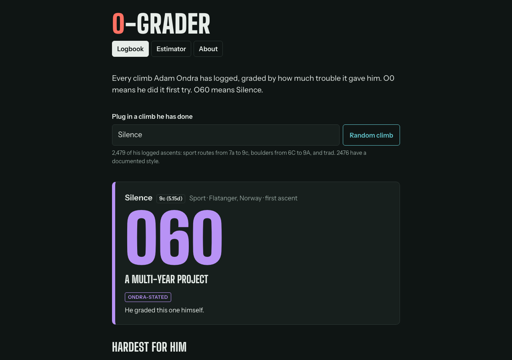

# O-Grader

**Live at [jackvermaak.com/ograder](https://jackvermaak.com/ograder/)**, and at
[jackingtothemax.com/ograder](https://jackingtothemax.com/ograder/), where the Worker in this
repository runs. Both serve the same pages and both pick up new ascents daily.

[](https://github.com/JackVermaak/ograder/actions/workflows/deploy.yml)
[](LICENSE)

[](https://jackvermaak.com/ograder/)

Every climb Adam Ondra has logged, graded by how much trouble it gave him.
O0 means he did it first try. O60 means Silence.

- **Logbook:** search 2,400+ of his sport routes, boulders and trad climbs and get each one's O-grade.
- **Estimator:** pick a grade and terrain to estimate the O-grade of a climb he has not done.
- **About:** what O-grades are, how each one is worked out, and where the data comes from.

## What an O-grade is

The Wide Boyz (Tom Randall and Pete Whittaker) proposed the scale: a flash is O0,
one session is O1, two sessions is O2. Ondra extended it with minus grades for
warm-ups and a plus or minus suffix for a hard fight or a casual send. The site
uses his own examples as fixed points.

## The data

**Where it comes from**

| What | Source |
| --- | --- |
| Routes and boulders, with style (onsight, flash, second go, redpoint) | Adam Ondra's [8a.nu logbook](https://www.8a.nu/user/adam-ondra/sportclimbing), cross-checked against the [list of routes](https://www.adamondra.com/list-of-routes) on adamondra.com |
| Session counts, try counts and trad ascents | [climbing-history.org](https://climbing-history.org/climber/467/adam-ondra), plus counts read from his own logbook comments |
| First-try rates by grade (the estimator) | His 8a.nu scorecard statistics |
| O-grades he gave himself (Silence O60, La Dura Dura O42+ …) | His own statements, used as fixed points |

**How it is refreshed**

1. `data/snapshot.txt` is a full snapshot of the logbook (12–13 November 2026).
2. `src/index.js`, the Worker, fetches his newest ascents from the climbing-history.org API at
   most once a day and serves them at `/ograder/latest.json`. The pages merge them in, so new
   sends appear without a redeploy.
3. Anything missed goes in `data/additions.txt` by hand. `npm run build` merges both files into
   `public/ograder/data.js` and stops on malformed or duplicate lines.

**How a climb is graded** (in order, first match wins)

1. **He stated it:** his own O-grade.
2. **Onsight or flash:** O0 at his limit, sliding down to O-3 for easy grades, using his own
   examples (DNA 7a is O-2-, Il Domani 9a onsight is O0+).
3. **Sessions, days or goes on record:** 5 sessions is O5; a second or third go is O1.
4. **Total tries on record:** up to 5 tries is one session; above that it assumes about four
   tries per session and shows the range.
5. **Redpoint with no session count:** his typical session count for that grade.

**How the estimator works.** For a grade he has climbed, the 8a.nu scorecard gives the share of
his sends done first try (80 % at 8a, 36 % at 8c, 4 % at 9a, none at 9b). If that share is 50 % or more, the
estimate is his first-try O-grade for that grade; otherwise it is his typical redpoint session
count, with a low–high range. Terrain shifts the grade first: his style (steep limestone) counts
as one grade easier, anti-style (slab, grit) two grades harder, offwidth five. The model tables are
`MODEL` and `STATS` in `public/ograder/app.js`; the file format is in [docs/DATA.md](docs/DATA.md).

## How it works

The site is a set of static pages served by a Cloudflare Worker.

- `public/ograder/` holds the pages, styles, script and fonts. `app.js` contains
  the grading logic and the estimator model.
- `public/ograder/data.js` holds every ascent. It is built from the files in `data/`.
- `src/index.js` adds one dynamic address, `/ograder/latest.json`. It fetches
  Ondra's newest ascents from climbing-history.org about once a day, and the
  pages merge them in, so new hard sends appear without a redeploy. It sends a
  CORS header, so the copy on jackvermaak.com (a static Cloudflare Pages site with no
  Worker) reads it from jackingtothemax.com.

The pages' canonical address is jackingtothemax.com/ograder, so search engines index one copy.
The jackvermaak.com copy is updated from this repository with `python3 tools/sync_ograder.py`
in the [jackvermaak.com](https://github.com/JackVermaak/jackvermaak.com) repository.

```
.
├── data/
│   ├── snapshot.txt      every ascent as of November 2026
│   └── additions.txt     ascents you add by hand
├── docs/DATA.md          data format and sources
├── test/                 unit tests (node --test)
├── public/
│   ├── index.html        sends the bare Worker address to /ograder/
│   ├── robots.txt
│   └── ograder/          the site
├── scripts/
│   └── build-data.mjs    builds data.js from data/
├── src/
│   └── index.js          the Worker
└── wrangler.jsonc        Worker name, routes and settings
```

## Running it locally

You need [Node.js](https://nodejs.org) 20 or newer.

```sh
npm install
npm run dev
```

Then open <http://localhost:8787/ograder/>.

## Deploying

From your own machine:

```sh
npx wrangler login   # once
npm run deploy
```

This builds `data.js` and deploys the Worker with the routes in `wrangler.jsonc`.
Deploy only this way: an upload through the Cloudflare dashboard would replace
the Worker script.

### Automatic deploys from GitHub

`.github/workflows/deploy.yml` checks every push and pull request. Pushes to
`main` also deploy, once you add two repository secrets under
**Settings → Secrets and variables → Actions**:

| Secret | Where to find it |
| --- | --- |
| `CLOUDFLARE_ACCOUNT_ID` | Cloudflare dashboard, Workers & Pages overview, right-hand side |
| `CLOUDFLARE_API_TOKEN` | My Profile → API Tokens → Create Token → "Edit Cloudflare Workers" template, limited to your account and the jackingtothemax.com zone |

Without the secrets the workflow still runs the checks and skips the deploy.

## Adding an ascent by hand

Add a line to `data/additions.txt`, for example:

```
S | Example Route | Flatanger, Norway | 9b | 2026 | s8!
```

The format and codes are explained at the top of that file and in
[docs/DATA.md](docs/DATA.md). Then run `npm run deploy`, or push to `main` if
automatic deploys are set up. The build stops with a clear message if a line
is malformed or the climb is already in the data.

## Checks and tests

```sh
npm run check   # builds the data, checks both scripts parse, validates the Worker config
npm test        # unit tests for grade conversion, the O-grade rules, the estimator and the Worker
```

Both run on every push and pull request with GitHub Actions. The tests load `app.js` in a fake
browser window, so they need nothing but Node.

## Credits

- O-grade scale: the Wide Boyz, extended by Adam Ondra.
- Data: Adam Ondra's logbook on [8a.nu](https://www.8a.nu/user/adam-ondra/sportclimbing),
  his [list of routes](https://www.adamondra.com/list-of-routes), and
  [climbing-history.org](https://climbing-history.org/climber/467/adam-ondra).
- Fonts: Big Shoulders Display and Instrument Sans, under the SIL Open Font License.

This is an unofficial fan project, not affiliated with Adam Ondra, the Wide Boyz,
8a.nu or climbing-history.org.

## Licence

The code is MIT licensed, see [LICENSE](LICENSE). The data and fonts are not
covered by that licence, see [DATA-NOTICE.md](DATA-NOTICE.md).
